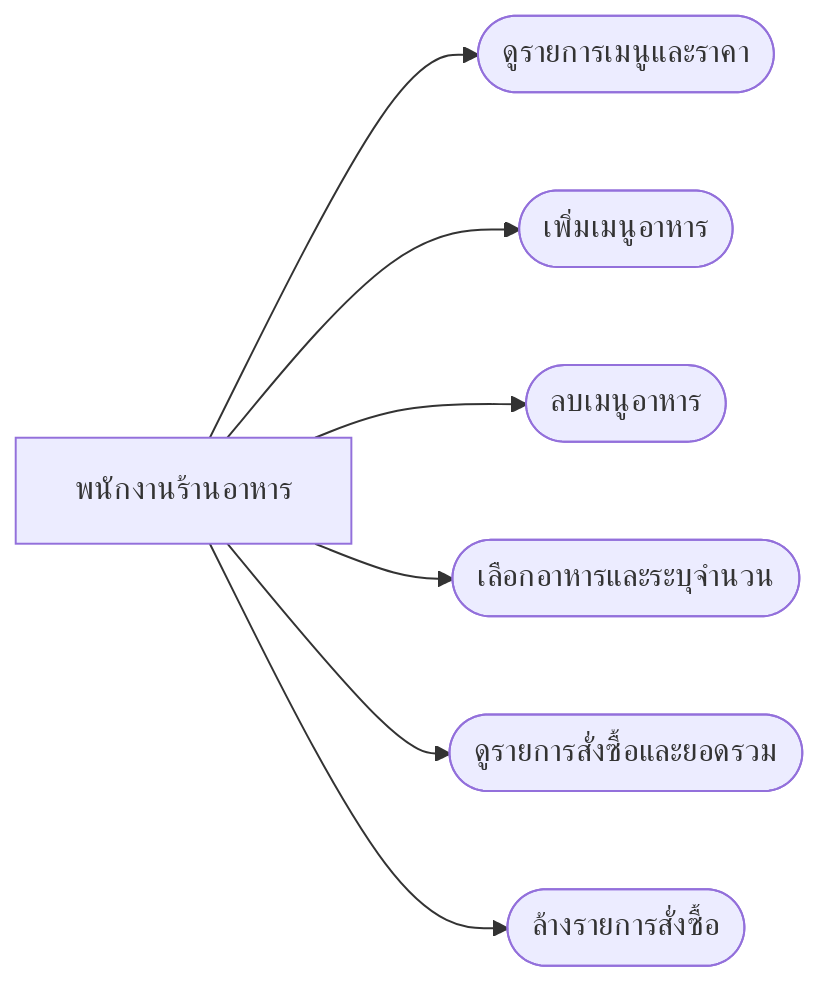
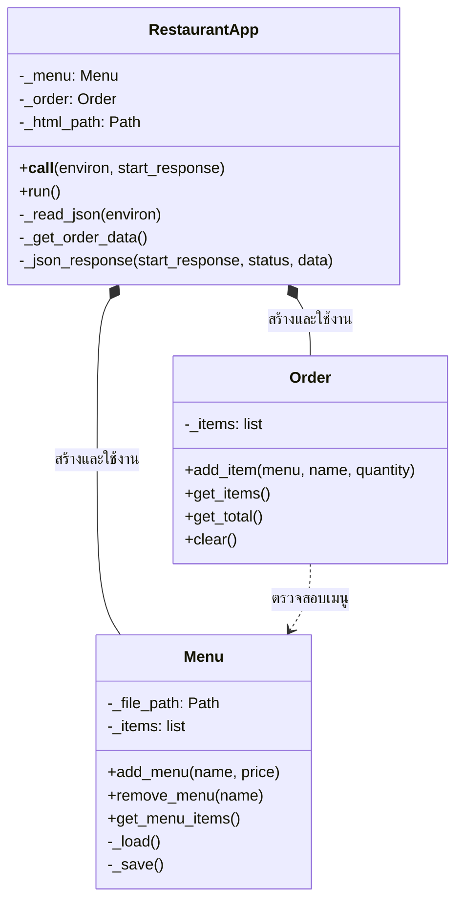

# Mini Restaurant Management System

ระบบจัดการร้านอาหารขนาดเล็ก ใช้หน้า HTML/CSS/JavaScript และ Python WSGI backend สำหรับเพิ่มเมนู เลือกอาหาร ระบุจำนวน และดูยอดรวม ข้อมูลเมนูถูกบันทึกใน `menu.json` โดยไม่ต้องใช้ฐานข้อมูลหรือระบบ Login

## โครงสร้างไฟล์

```text
Team-software/
├── main.py       # คลาส Menu, Order และ RestaurantApp รวมถึง WSGI backend
├── index.html    # หน้าจอ HTML, CSS และ JavaScript
├── menu.json     # ข้อมูลเมนูอาหารที่บันทึกถาวร
└── README.md     # เอกสารออกแบบและวิธีใช้งาน
```

## วิเคราะห์ระบบ (OOAD)

**ผู้ใช้งาน:** พนักงานร้านอาหาร

**Use Case Diagram**



**ลำดับการทำงานหลัก:** เปิดโปรแกรมและโหลดเมนูจาก JSON → เลือกอาหารและจำนวน → เพิ่มรายการลงคำสั่งซื้อ → ระบบคำนวณยอดรวมและแสดงบนหน้าจอ เมื่อต้องเพิ่มอาหารใหม่ พนักงานบันทึกชื่อและราคา แล้วระบบบันทึกข้อมูลลง JSON ทันที

## Class Diagram



## หลัก OOP และการแบ่งงาน

- **Class และ Object:** `Menu`, `Order`, `RestaurantApp` เป็นแม่แบบ เมื่อเริ่มโปรแกรม `RestaurantApp` จะสร้าง object ของ `Menu` และ `Order` เพื่อทำงานร่วมกัน
- **Encapsulation:** เก็บข้อมูลภายในไว้ในแอตทริบิวต์ `_items`, `_file_path` และ `_order` โดยให้คลาสจัดการผ่านเมธอด เช่น `add_menu()`, `add_item()` และ `get_total()`
- **แบ่งความรับผิดชอบ:** `Menu` จัดการเมนูและ JSON, `Order` จัดการรายการอาหารและยอดรวม, `RestaurantApp` ดูแลหน้าจอและประสานการทำงาน
- **สมาชิกคนที่ 1:** รับผิดชอบคลาส `Menu`
- **สมาชิกคนที่ 2:** รับผิดชอบคลาส `Order`
- **ทำงานร่วมกัน:** ออกแบบและพัฒนาคลาส `RestaurantApp` รวมถึงทดสอบการเชื่อมต่อระหว่างคลาส

## ติดตั้งและเปิดใช้งาน

ต้องมี Python 3.9 ขึ้นไป และเว็บเบราว์เซอร์สมัยใหม่ ไม่ต้องติดตั้งไลบรารี Python เพิ่ม

เปิด Terminal ในโฟลเดอร์โปรเจกต์ แล้วรัน:

```powershell
python main.py
```

จากนั้นเปิดเบราว์เซอร์ไปที่ <http://127.0.0.1:8000> หากต้องการปิดระบบ ให้กด `Ctrl+C` ใน Terminal

## วิธีใช้งาน

1. รายการอาหารและราคาจะแสดงในฝั่ง **เมนูอาหาร**
2. เพิ่มเมนูโดยกรอกชื่อและราคา แล้วกด **บันทึกเมนู** ข้อมูลจะถูกเขียนลง `menu.json` ทันที
3. กด **ลบ** ข้างเมนูที่ต้องการ แล้วตอบยืนยัน เมนูจะถูกลบจาก `menu.json`
4. เลือกเมนู ระบุจำนวน แล้วกด **เพิ่มรายการ** เพื่อเพิ่มอาหารลงในคำสั่งซื้อ
5. ตรวจชื่ออาหาร จำนวน ราคาต่อชิ้น ยอดย่อย และยอดรวม จากนั้นกด **ล้างรายการ** เมื่อต้องการเริ่มคำสั่งซื้อใหม่
6. ปิดแล้วเปิดระบบอีกครั้ง การเพิ่มและลบเมนูจะยังคงถูกบันทึกไว้

## กรณีทดสอบ

| กรณี | ขั้นตอน | ผลที่คาดหวัง |
|---|---|---|
| เพิ่มเมนู | เพิ่ม `ชาเย็น` ราคา `25` | แสดงในรายการเมนู และข้อมูลถูกบันทึกใน `menu.json` |
| ลบเมนู | กด **ลบ** ข้าง `ชาเย็น` และยืนยัน | เมนูหายจากหน้าจอและ `menu.json` |
| เลือกอาหาร | เลือก `ข้าวผัด` จำนวน `2` แล้วกดเพิ่มรายการ | แสดงข้าวผัดจำนวน 2 จาน ยอดย่อย 120.00 บาท |
| คำนวณยอดรวม | เพิ่มข้าวผัด 2 จาน (120 บาท) และน้ำเปล่า 1 ขวด (10 บาท) | ยอดรวม 130.00 บาท |
| ตรวจจำนวนไม่ถูกต้อง | เพิ่มรายการโดยระบุจำนวน 0 | แจ้งเตือน และไม่เพิ่มรายการ |
| ตรวจการบันทึกถาวร | เพิ่มเมนู ปิดแล้วเปิดโปรแกรมใหม่ | เมนูที่เพิ่มยังแสดงอยู่ |
